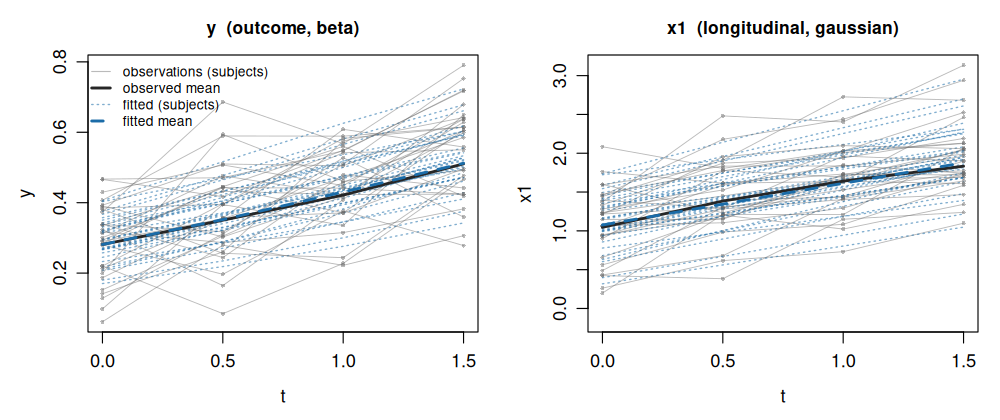
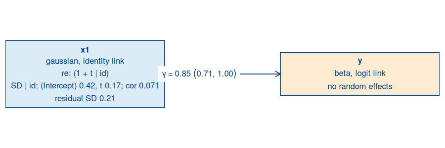

# mvrem: Multivariate Joint Models with INLA

mvrem fits **joint models of several longitudinal markers and outcomes** with the Integrated
Nested Laplace Approximation ([INLA](https://www.r-inla.org)). Each response has its own
family (Gaussian, beta, binomial, Poisson, survival, ...), fixed effects and random effects. An
outcome is linked to a marker through the marker's linear predictor (its fixed and random
effects), scaled by an estimated association coefficient $\gamma$. The two need not be measured
at the same times.

The model is written in lme4-style formulae and fitted with one call, `jsm()`. The package
builds INLA's stacked data, `f()` terms and copies, so no knowledge of INLA is needed.

> **Status:** under development; the interface may still change. A time-varying
> ("current value") survival association is not implemented yet, and the default priors are
> not final.

## Installation

INLA is not on CRAN. Install it from its own repository first, then mvrem from GitHub:

```r
install.packages("INLA",
                 repos = c(getOption("repos"),
                           INLA = "https://inla.r-inla-download.org/R/stable"),
                 dep = TRUE)
install.packages(c("remotes", "htmlwidgets"))     # htmlwidgets: interactive plots (optional)
remotes::install_github("LUMC/mvrem", build_vignettes = TRUE)
```

## Example

A beta-distributed outcome `y` depends on the level of a Gaussian marker `x1`, which has a
random intercept and slope per subject (simulated data, 50 subjects with 4 visits):

```r
library(mvrem)

set.seed(1)
n <- 50
d <- data.frame(id = sprintf("S%03d", rep(seq_len(n), each = 4)),
                t  = rep(c(0, 0.5, 1, 1.5), n))
i <- as.integer(factor(d$id))
b0 <- rnorm(n, sd = 0.5); b1 <- rnorm(n, sd = 0.2)
eta <- 1 + 0.5 * d$t + b0[i] + b1[i] * d$t                  # marker level (latent)
d$x1 <- eta + rnorm(nrow(d), sd = 0.2)                       # marker, measured
mu <- plogis(-1 + 0.3 * d$t + 0.8 * (eta - 1))               # gamma = 0.8
d$y <- rbeta(nrow(d), 30 * mu, 30 * (1 - mu))                # outcome, phi = 30
```

All formulae go in one list. A formula with a `scaled()` term is an outcome, linked to the
marker named in it; a formula without one is a marker:

```r
m <- jsm(
  list(y  ~ 1 + t + scaled(x1),
       x1 ~ 1 + t + re(1 + t | id, prior = wishartPrec(scale = "data"))),
  data   = d,
  family = list(y = betaFamily())
)
estimatesTable(m)
```

```
 response type        parameter                mean (sd)      95% interval
 y        fixed       (Intercept)              -1.86 (0.0967) [-2.05, -1.67]
          fixed       t                        0.208 (0.0669) [0.0753, 0.338]
          association gamma (x1 -> y)          0.851 (0.0746) [0.706, 1]
          family      phi                      28 (2.95)      [22.6, 34.2]
 x1       fixed       (Intercept)              1.04 (0.0654)  [0.914, 1.17]
          fixed       t                        0.532 (0.0366) [0.46, 0.604]
          sd          SD (Intercept) | id      0.423 (0.0468) [0.34, 0.523]
          sd          SD t | id                0.172 (0.031)  [0.118, 0.24]
          correlation corr (Intercept), t | id 0.0714 (0.201) [-0.319, 0.46]
          residual    residual SD              0.212 (0.014)  [0.186, 0.241]
```

`plot(m)` shows the data and the fitted values of every equation (an interactive widget when
htmlwidgets is installed), and `plotModel(m)` draws the model:





`latexEquation(m)` writes the model as LaTeX:

```math
\begin{aligned}
x_{1,i} &= \beta^{(x_{1})}_{0} + \beta^{(x_{1})}_{1}\, t_{i} + b^{(x_{1})}_{0,\mathrm{id}[i]} + b^{(x_{1})}_{1,\mathrm{id}[i]}\, t_{i} + \varepsilon^{(x_{1})}_{i} \\
0 &= \beta^{(x_{1})}_{0} + \beta^{(x_{1})}_{1}\, t + b^{(x_{1})}_{0,\mathrm{id}} + b^{(x_{1})}_{1,\mathrm{id}}\, t - u^{(x_{1} \to y)}_{\mathrm{id},t}, \quad \left(\mathrm{id}, t\right) \in \mathcal{D}_{y} \\
\operatorname{logit}\left(\mu^{(y)}_{i}\right) &= \beta^{(y)}_{0} + \beta^{(y)}_{1}\, t_{i} + \gamma_{y,x_{1}}\,u^{(x_{1} \to y)}_{\mathrm{id}[i],t_{i}} \\
\varepsilon^{(x_{1})}_{i} &\sim \mathcal{N}\left(0, \left(\tau^{(x_{1})}_{\varepsilon}\right)^{-1}\right) \\
\left(b^{(x_{1})}_{0,l}, b^{(x_{1})}_{1,l}\right)^\top &\sim \mathcal{N}\left(\mathbf{0}, \left(\mathbf{Q}^{(x_{1})}_{\mathrm{id}}\right)^{-1}\right), \quad l = 1, \ldots, n_{\mathrm{id}} \\
\mathbf{Q}^{(x_{1})}_{\mathrm{id}} &\sim \mathcal{W}_{2}\left(4, \begin{pmatrix}1.52 & -0.435 \\ -0.435 & 8.37\end{pmatrix}\right) \\
y_{i} &\sim \mathrm{Beta}\left(\mu^{(y)}_{i}\, \phi^{(y)}, \left(1 - \mu^{(y)}_{i}\right) \phi^{(y)}\right) \\
u^{(x_{1} \to y)}_{\mathrm{id},t} &\sim \mathcal{N}\left(0, \left(\tau_{x_{1} \to y}\right)^{-1}\right)
\end{aligned}
```

The zero equation defines $u$ as the marker's linear predictor at each (subject, time) of the
outcome data; the outcome uses $\gamma u$.

## Writing a model

- **Random effects** as in lme4: `(1 + t | id)` correlated, `(1 + t || id)` uncorrelated;
  `re(1 + t | id, prior = ...)` sets the prior of the block.
- **Associations**: `scaled(x1)` in an outcome formula links it to the marker `x1`;
  `scaled(x1, prior = normalCoef(0, 1))` sets the prior of $\gamma$. An outcome may name
  several markers.
- **Family inputs** after the response: `k | trials(n) ~ ...` (binomial),
  `cnt | exposure(pt) ~ ...` (counts), `time | event(status) ~ ...` (survival),
  `x | weights(w) ~ ...` (observation weights).
- **Data**: one data frame for all formulae, or a list named by response; `dataOut` /
  `dataLong` for separate outcome and marker data.
- **Families**: `family = list(y = betaFamily(), k = binomialFamily(link = "probit"), cnt =
  "poisson")`; responses not listed are Gaussian.

| Families | |
|---|---|
| continuous | `gaussianFamily()`, `studentTFamily()`, `lognormalFamily()`, `gammaFamily()`, `betaFamily()` |
| counts | `poissonFamily()`, `negBinomialFamily()`, `binomialFamily()`, `betaBinomialFamily()`, `zeroInflatedPoissonFamily()`, `zeroInflatedNegBinomialFamily()` |
| survival | `weibullSurvFamily()`, `exponentialSurvFamily()` |
| any other INLA likelihood | `inlaFamily()` |

| Priors | |
|---|---|
| single or uncorrelated random effects | `gammaPrec()`, `pcSd()`, `halfNormalSd()`, `halfCauchySd()` |
| correlated blocks | `wishartPrec()` |
| association coefficients | `normalCoef()` |

The scale of a random-effect prior can be taken from an lme4 fit of the same formula
(`pcSd(u = "data")`, `wishartPrec(scale = "data")`, ...), which makes it unit-free.

## Results

| Function | Gives |
|---|---|
| `summary()`, `estimatesTable()` | all estimates with readable names; `format(.., "markdown" / "latex")` for reports |
| `fixedEffects()`, `associations()`, `hyperparameters()`, `coef()` | posterior summaries |
| `randomEffects()`, `varianceComponents()` | subject effects; SDs, correlations and covariance matrices |
| `fittedValues()`, `residuals()`, `modelFit()` | fitted means and residuals; DIC, WAIC, log score |
| `predict(m, newdata)` | posterior of the mean for new subjects or new times; `plot()` of the result |
| `plot()`, `plotResiduals()`, `plotRandomEffects()`, `plotVarianceComponents()`, `plotFixedEffects()`, `plotAssociations()` | data and fit, diagnostics, posteriors |
| `plotModel()`, `latexEquation()` | diagram and equations of the model |
| `update()`, `refit()` | re-run with changed arguments or INLA options |
| `inlaFormula()`, `inlaData()`, `inlaArguments()`, `inlaFit()` | what was given to INLA, and its result |

`jsm(..., fit = FALSE)` builds the model without running INLA, so it can be inspected first.

## Documentation

- **Getting started**: the vignette, `vignette("mvrem")`, also online at
  <https://lumc.github.io/mvrem/>.
- The help pages, e.g. `?jsm`, `?families`, `?priors`, `?predict.mvremModel`.

## Authors and licence

Szymon M. Kiełbasa and Chiara Degan (authors), Roula Tsonaka and Bart Mertens (contributors);
Leiden University Medical Center. Licence: GPL (>= 2).

Much of the code, tests and documentation was developed with Claude Code, Anthropic's AI
assistant, under the direction of the authors. Commits with its contributions carry a
`Co-Authored-By: Claude` line.

Contributions are welcome: see [CONTRIBUTING.md](CONTRIBUTING.md), a step-by-step guide to
forks and pull requests written for statisticians new to Git. It also describes the
development container, which has INLA preinstalled.
